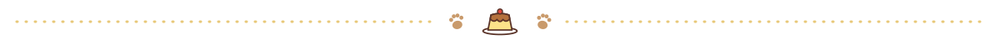
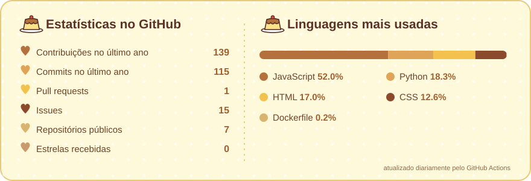

 

 

## 🍮 Sobre mim

Sou **Engenheiro de Software** e trabalho com desenvolvimento desde 2023, sempre em sistemas corporativos
que precisam sustentar regras de negócio complexas sem perder confiabilidade. Passei por gestão de
indenizações e emissão de apólices de seguro, e hoje atuo em uma **plataforma distribuída, orientada a
eventos**, formada por vários serviços que conversam entre si.

Meu forte é **.NET (C#, ASP.NET), React.js e SQL**, com vivência em integração de sistemas e conhecimento
em Java/Spring Boot e fundamentos de AWS. Gosto de trabalhar perto de produto, QA e negócio para
transformar regras complexas em código confiável e fácil de manter.

- 🍮 &nbsp;Hoje sou **Engenheiro de Software na Meerkat**, com .NET, gRPC, Kafka e PostgreSQL
- 💛 &nbsp;Sou **Embaixador Estudantil do Google 2026**, levando IA com o Gemini para outros estudantes
- 🐾 &nbsp;Sou **Diretor de Assuntos Estudantis no CATI**, o centro acadêmico de TI da UFLA
- 🎓 &nbsp;Estou me formando em **Sistemas de Informação na UFLA** (2021 a 2026)
- 🍯 &nbsp;Estou explorando **IA generativa e LLMs**
- 📍 &nbsp;Lavras, Minas Gerais, Brasil

 

## 🐾 Trajetória

| Quando | Onde | O que faço / fiz |
| :-- | :-- | :-- |
| **jun/2026 a hoje** | 🍮 **Meerkat**, Engenheiro de Software | Serviços .NET/C# em uma plataforma distribuída: integração com gRPC e Kafka, PostgreSQL com EF Core, Keycloak/JWT multi-tenant, CI/CD com GitHub Actions e Docker |
| **ago/2025 a mai/2026** | 🍯 **Squadra Digital**, Analista de Desenvolvimento | Setor de seguros: emissão, renovação e endosso de apólices, integrações entre sistemas, full stack com .NET e React.js |
| **fev/2023 a nov/2024** | 🐾 **Squadra Digital**, Analista de Desenvolvimento | Fundação Renova: APIs REST e regras de negócio dos fluxos de indenização, full stack com React.js e .NET |

## 💛 Liderança e comunidade

<table>
  <tr>
    <td width="50%" valign="top">
      <h3>💛 Embaixador Estudantil do Google 2026</h3>
      <b>Google</b> · ago/2026 a dez/2026
      

        Faço parte do Programa Estudantes Embaixadores do Google, uma comunidade que reúne universitários
        de todo o Brasil para trocar experiências práticas sobre o <b>Google Gemini</b>. É uma jornada de
        capacitação digital e liderança: meu papel é ser referência em IA no campus da UFLA.
      

    </td>
    <td width="50%" valign="top">
      <h3>🐾 Diretor de Assuntos Estudantis</h3>
      <b>CATI Grace Hopper</b> · jun/2024 a hoje
      

        Faço a ponte entre os estudantes e a coordenação do curso. Organizei a semana de TI, com
        <b>264 participantes</b> e parcerias com BIP, SYDLE, CloudWalk, Nexos, LEVTY e YOUX, e montei um
        fluxo digital para acompanhar as demandas dos estudantes.
      

    </td>
  </tr>
</table>

## 🍯 Tecnologias

**Back end** 

**Front end** 

**Dados e integração** 

**Infraestrutura e IA** 

## 🧁 Projetos em destaque

| Projeto | Sobre | Stack |
| :-- | :-- | :-- |
| 🍮 [**Kitchen_Guardian_Django**](https://github.com/RATZogun/Kitchen_Guardian_Django) | Controle de estoque para cozinhas, com lotes, validades, alertas e perfis de acesso | Django, Unfold, Bootstrap |
| 🍯 [**Kitchen_Guardian**](https://github.com/RATZogun/Kitchen_Guardian) | A primeira versão do Guardião da Cozinha, com requisitos, diagramas e testes | Node.js, React, PostgreSQL |
| 🐾 [**Technology_Prospecting_Project**](https://github.com/RATZogun/Technology_Prospecting_Project) | API containerizada com builds multi-stage, estudo sobre microsserviços | FastAPI, PostgreSQL, Docker |
| 💛 [**DnD5_Compendium**](https://github.com/RATZogun/DnD5_Compendium) | Compêndio de D&D 5e com magias, classes e espécies em português e inglês | JavaScript |
| 🧁 [**Personal_Page**](https://github.com/RATZogun/Personal_Page) | Minha página pessoal, em duas versões: Bootstrap e Tailwind CSS | HTML, CSS, JavaScript |

## 🍮 Estatísticas

 &nbsp;Feito com pudim 🍮, caramelo 🍯 e muitas patinhas 🐾
 
Ilustrações do Pompompurin e da turma: <a href="https://www.vecteezy.com">Vecteezy.com</a>. Personagens © Sanrio.

